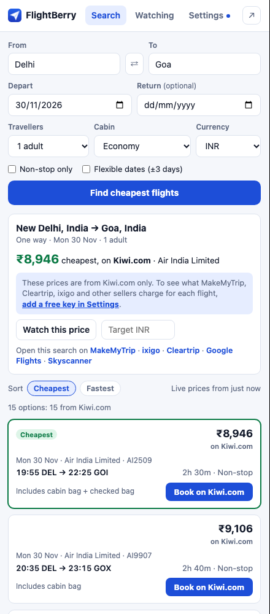

<div align="center">


# FlightBerry

**Find the cheapest flight, see who is selling it, and get told when the price drops.**

A lightweight browser extension for Chrome and Brave that searches live fares,
labels every price with its source, and watches your routes in the background.


</div>

---

## Contents

- [Overview](#overview)
- [Features](#features)
- [Where prices come from](#where-prices-come-from)
- [Installation](#installation)
- [Usage](#usage)
- [Seller prices (optional)](#seller-prices-optional)
- [Privacy and permissions](#privacy-and-permissions)
- [Limitations](#limitations)
- [Project structure](#project-structure)
- [Development](#development)
- [Disclaimer](#disclaimer)

## Overview



Flight prices differ between booking sites, and checking each one by hand is slow.
FlightBerry runs the search from your toolbar and answers three questions:

1. **What is the cheapest flight** for my route and date?
2. **Who is selling it**, and at what price?
3. **Has it become cheaper** since I last looked?

It works out of the box with no account. Adding a free API key unlocks a
per-seller price breakdown covering sites such as MakeMyTrip, Cleartrip and
ixigo, alongside the airline's own price.

<br clear="right">

## Features

| | Feature | What it does |
| --- | --- | --- |
| 🔎 | **Live search** | Fetches fares at the moment you search. Nothing is pre-cached. |
| 🏷️ | **Source on every price** | Each fare shows where it came from, and the summary names the cheapest seller. |
| 🛒 | **Compare sellers** | Lists what each booking site and the airline charge for the same flight, lowest first. |
| 🔔 | **Price watch** | Saves a route, re-checks it about every 3 hours, and notifies you on a drop or when your target price is reached. |
| 📅 | **Flexible dates** | Searches 3 days either side of your date to find a cheaper day. |
| 🧭 | **Smart place matching** | Around 150 built-in cities, with multi-airport cities handled for you (Goa, London, New York, Tokyo). |
| 🔗 | **One-click cross-check** | Opens the same search on MakeMyTrip, ixigo, Cleartrip, Google Flights and Skyscanner. |
| ⚙️ | **Search options** | One way or return, 1 to 9 adults, four cabin classes, ten currencies, non-stop only. |
| 🌗 | **Light and dark** | Follows your system theme. |

## Where prices come from

| Source | Needs a key | What it provides |
| --- | --- | --- |
| **Kiwi.com** | No | Live fares across most airlines, including low-cost carriers. Used for every search and for price watches. |
| **Google Flights** (via [SerpApi](https://serpapi.com)) | Yes, free | A second set of live fares, plus the price each seller charges for a given flight. |

MakeMyTrip, ixigo and Cleartrip do not offer a public price feed. FlightBerry
does not scrape them. Their prices are shown when Google Flights lists them as a
seller for a flight, and each result set links straight to the same search on
their sites.

## Installation

FlightBerry is loaded as an unpacked extension. There is nothing to build or install first.

1. Download or clone this repository.
   ```bash
   git clone https://github.com/AyushZorix/Flyberry.git
   ```
2. Open `chrome://extensions` (or `brave://extensions`).
3. Turn on **Developer mode** in the top right.
4. Click **Load unpacked** and select the repository folder.
5. Pin **FlightBerry** from the puzzle-piece menu so it stays in the toolbar.

After pulling an update, press the reload arrow on the extension's card.

## Usage

**Search.** Enter From, To and a departure date, then press **Find cheapest
flights**. A search takes roughly 5 to 15 seconds. Results are sorted cheapest
first, and you can switch to fastest.

**Pick places from the suggestions** where you can. Typed names that are not in
the list are sent as written and matched by the flight service, which can pick a
different city with a similar name. The results header always shows the city and
country that were matched, so check it before you book.

**Return trips.** Fill in the Return date. Leave it empty for one way.

**Watch a price.** After a search, press **Watch this price**, and optionally
enter a target. The **Watching** tab lists every saved route with its current
price, the change since you started, and the lowest price seen. Clicking a
notification opens the booking page.

**Bigger view.** The arrow button in the header opens FlightBerry in a full tab.

## Seller prices (optional)

Adding a free SerpApi key turns on Google Flights fares and the **Compare
sellers** breakdown.

1. Create a free account at [serpapi.com](https://serpapi.com/users/sign_up).
2. Copy your private API key from the dashboard.
3. In FlightBerry, open **Settings**, paste the key and press **Save**. The key
   is checked immediately and your remaining searches are shown.

**Free plan usage** (250 searches a month):

| Action | Searches used |
| --- | --- |
| One-way flight search | 2 |
| Return flight search | 3 |
| Extra **Compare sellers** click, one way | 1 |
| Extra **Compare sellers** click, return | 2 |
| Price-watch background checks | 0 |

The sellers listed for a flight are whichever ones Google Flights shows for it,
so not every site appears on every flight.

## Privacy and permissions

FlightBerry has no server, no analytics and no account system.

- Searches, watched routes and your API key are stored only in your browser.
- Search details (route, dates, passengers) are sent to the flight data
  services below and nowhere else.
- The API key is sent only to `serpapi.com`.

| Permission | Why it is needed |
| --- | --- |
| `storage` | Remember your last search, watched routes and API key. |
| `alarms` | Re-check watched routes on a timer. |
| `notifications` | Tell you when a price drops or reaches your target. |
| `https://mcp.kiwi.com/*` | Fetch live fares from Kiwi.com. |
| `https://serpapi.com/*` | Fetch Google Flights fares and seller prices (only when a key is set). |

## Limitations

- **Final price.** Fares are live when fetched, but the price is only confirmed
  on the seller's booking page. Card fees and offers can change the total.
- **Background checks** run only while the browser is open.
- **Flexible dates** apply to Kiwi.com fares. Google Flights fares cover the
  exact date you picked.
- **Travellers** are adults only for now. Children and infants are not supported.
- **Browsers.** Chrome, Brave and other Chromium browsers. Safari is not supported.

## Project structure

```
.
├── manifest.json        Extension definition (Manifest V3)
├── popup.html           Search, Watching and Settings views
├── popup.css            Styles, light and dark themes
├── popup.js             Interface logic and rendering
├── background.js        Timed price checks, notification clicks
├── icons/               Toolbar and store icons
├── docs/                README images
└── src/
    ├── api.js           Kiwi.com live fare search
    ├── google.js        Google Flights fares and prices by seller
    ├── airports.js      Place suggestions and name-to-code matching
    └── watches.js       Saved watches and price-drop detection
```

## Development

The extension is plain HTML, CSS and JavaScript modules with no dependencies and
no build step.

1. Edit the files.
2. Press the reload arrow on the extension's card at `chrome://extensions`.
3. Reopen the popup.

To debug, right-click the popup and choose **Inspect** for the interface, or
click **service worker** on the extension's card for background price checks.

## Disclaimer

FlightBerry is an independent personal project. It is not affiliated with or
endorsed by Kiwi.com, Google, SerpApi, MakeMyTrip, ixigo, Cleartrip, Skyscanner
or any airline. All trademarks belong to their owners. Prices are provided by
third parties and may change; always confirm the final price before paying.
